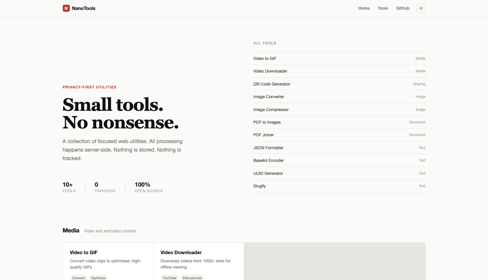

# nanotools

[](https://github.com/tmunongo/nanotools/actions/workflows/release.yml)
[](https://github.com/tmunongo/nanotools/pkgs/container/nanotools)
[](https://github.com/tmunongo/nanotools/tags)
[](go.mod)

A self-hostable collection of privacy-first web utilities built in Go.

It's mostly a collection of tools that I often find myself looking up online, but it's usually never clear whether or not my JSON response with API keys, etc. will end up in the wrong hands.



## Stack

- Go
- chi
- sqlc
- Templ
- HTMX
- Alpine.js
- SQLite

## Features

Privacy First: All processing happens on your server
- ✅ JSON Formatter: Validate and beautify JSON
- ✅ Text Utils: Base64, slugify, UUID, hashing
- ✅ Image Tools: Convert, compress, and process images
- ✅ PDF Tools: Convert PDFs to images, join PDFs
- 🕐 Video Tools: 
    - [] Create GIFs from video clips
    - ✅ Download online videos
- ✅ QR code generation
- ✅ Easy deploy with Docker, Docker Compose, and Kamal

---

## Self-Hosting with Docker Compose

Nanotools is packaged as a lightweight, multi-arch (`linux/amd64`, `linux/arm64`) container image published automatically to GitHub Container Registry (`ghcr.io`).

### 1. Quick Start

Create a `docker-compose.yml` file (or use the one included in this repository):

```yaml
services:
  nanotools:
    image: ghcr.io/tmunongo/nanotools:latest
    container_name: nanotools
    restart: unless-stopped
    ports:
      - "8080:8080"
    environment:
      - PORT=8080
      - DATABASE_PATH=/app/data/tinyutils.db
    volumes:
      - nanotools_data:/app/data

volumes:
  nanotools_data:
```

Start the container in detached mode:

```bash
docker compose up -d
```

Open your browser and navigate to `http://localhost:8080`.

### 2. Useful Commands

- **Check container status**: `docker compose ps`
- **View real-time logs**: `docker compose logs -f`
- **Update to latest image**:
  ```bash
  docker compose pull
  docker compose up -d
  ```
- **Stop service**: `docker compose down`

### 3. Environment Variables

| Variable | Default | Description |
|---|---|---|
| `PORT` | `8080` | Port on which the HTTP server listens inside the container |
| `DATABASE_PATH` | `/app/data/tinyutils.db` | Absolute or relative path to the SQLite database file |

### 4. Data Persistence

Nanotools uses SQLite to store audit and session data. The database file resides inside `/app/data`. The volume mapping `nanotools_data:/app/data` ensures your database persists across container restarts and updates.

If you prefer a host bind-mount instead of a named volume, use:

```yaml
    volumes:
      - ./data:/app/data
```

### 5. Reverse Proxy Configuration

When exposing Nanotools behind a reverse proxy (e.g., Caddy, Nginx, Traefik), ensure you forward client IP headers and configure a sufficient client request body size (at least 50MB) for image/PDF uploads:

#### Caddy Example
```caddy
tools.yourdomain.com {
    reverse_proxy nanotools:8080
}
```

#### Nginx Example
```nginx
server {
    listen 80;
    server_name tools.yourdomain.com;
    client_max_body_size 50M;

    location / {
        proxy_pass http://localhost:8080;
        proxy_set_header Host $host;
        proxy_set_header X-Real-IP $remote_addr;
        proxy_set_header X-Forwarded-For $proxy_add_x_forwarded_for;
        proxy_set_header X-Forwarded-Proto $scheme;
    }
}
```

### 6. Building from Source

To build and run directly from the source repository:

```bash
git clone https://github.com/tmunongo/nanotools.git
cd nanotools
docker compose up -d --build
```

---

## Development & Version Bumping

A `Makefile` is provided with targets to manage SemVer tagging and automated GHCR releases:

```bash
# Check current version from git tags
make version

# Bump semver versions and create an annotated git tag
make bump-patch    # v0.1.0 -> v0.1.1 (alias: make patch)
make bump-minor    # v0.1.0 -> v0.2.0 (alias: make minor)
make bump-major    # v0.1.0 -> v1.0.0 (alias: make major)

# Tag a custom version manually
make tag VERSION=v1.2.3

# Push tags to trigger GitHub Actions build & release to GHCR
make push-tags

# Or bump and immediately push in one command
make release-patch
make release-minor
make release-major
```
